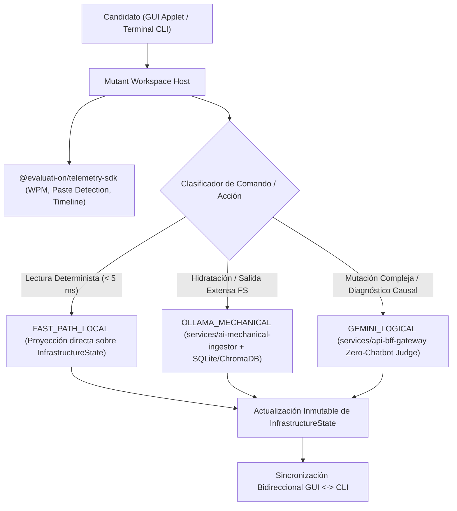

# Software Architecture Document (SAD) — EvaluaTI-ON_Killua_V1.0

**Versión:** 1.0.0 (Hito M0 — Fundación Institucional)  
**Estado:** Aprobado  
**Repositorio Objetivo:** `https://github.com/jevallejos/EvaluaTI-ON_Killua_V1.0.git`

---

## 1. Visión Arquitectónica General

**EvaluaTI-ON_Killua_V1.0** es una plataforma de evaluación práctica y forense de talento en Infraestructura Crítica TI, SRE, Administración de Sistemas (RHEL 8 / Windows Server 2019), Virtualización (VMware vCenter / ESXi 8), Hardware Bare-Metal (Lenovo XClarity BMC) y Seguridad Perimetral (FortiGate 7.6.1).

A diferencia de los laboratorios basados en máquinas virtuales pesadas (costosos y lentos de aprovisionar) o los cuestionarios estáticos de opción múltiple, **EvaluaTI-ON_Killua_V1.0** implementa una arquitectura de **Cascarones Vacíos Reactivos (*Reactive Empty Shells*)** gobernados por un **Shadow State JSON (`InfrastructureState`)** y una **Orquestación Híbrida de Doble IA (Ollama Local + Google Gemini)**.

---

## 2. Topología de las 4 Capas de Infraestructura Emuladas (`L1` a `L4`)

| Capa | Identificador (`PlatformLayerId`) | Micro-App (`apps/*`) | Subsistema Emulado |
| :--- | :--- | :--- | :--- |
| **L1 — Hardware / BMC** | `L1_XCLARITY_BMC` | `apps/xclarity-app` | Lenovo XClarity Controller: sensores térmicos, fuentes redundantes PSU, arreglos RAID físicos y registros SEL/BMC. |
| **L2 — Hipervisor** | `L2_VCENTER_ESXI8` | `apps/vcenter-server-app` | VMware vSphere Client / ESXi 8.0: clústeres HA/DRS, datastores VMFS/vSAN, vSwitches distribuidos y máquinas virtuales. |
| **L3 — SO Linux** | `L3_RHEL8_LINUX` | `apps/rhel-8-gui-app` | Red Hat Enterprise Linux 8: consola web Cockpit, escritorio GNOME, `systemd`, `nmcli`, LVM, SELinux y terminal Bash. |
| **L3 — SO Windows** | `L3_WIN2019_SERVER` | `apps/windows-server-app` | Windows Server 2019: Server Manager, Active Directory / SYSVOL, DNS, IIS Application Pools, Event Viewer y PowerShell. |
| **L4 — Firewall NGFW** | `L4_FORTIGATE_761` | `apps/fortigate-app` | FortiGate FortiOS 7.6.1: políticas IPv4, túneles IPsec Fase 1/2, SD-WAN SLA Health Checks, tablas de ruteo y FortiOS CLI. |

Además, el ecosistema incluye tres aplicaciones transversales:
- `apps/corporate-portal-app`: Portal institucional de acceso, autenticación de sesiones y selección de evaluaciones.
- `apps/mutant-workspace-host`: Contenedor camaleónico principal que monta dinámicamente los cascarones `L1..L4`, el ticket de misión y las ventanas flotantes.
- `apps/executive-scorecard-app`: Panel ejecutivo para reclutadores y arquitectos con el puntaje de certeza operativa y el reproductor **Time-Machine Forense**.

---

## 3. Flujo de Ejecución y Orquestación de Doble IA

### 3.1. Pre-Calentamiento Predictivo al 50% de Progreso
Cuando el candidato supera el 50% de los checkpoints del reto activo (`currentMissionIndex`), el servicio `ai-mechanical-ingestor` hidrata en segundo plano el cascarón del siguiente ticket en `missionQueue` utilizando Ollama y `filesystem_metadata.db`, logrando transiciones entre misiones en `< 50 ms`.

---

## 4. Estructura de Paquetes Compartidos (`packages/*`)

1. **`@evaluati-on/shared-types`**: Contrato único de tipos TypeScript, `InfrastructureState`, `INITIAL_EMPTY_INFRASTRUCTURE_STATE` y sanitización Anti-Spoiler (`sanitizeMissionTicketForRole`).
2. **`@evaluati-on/window-manager`**: Gestión determinista de ventanas flotantes mediante `useWindowManagement`, asignando `zIndex: 50` a la ventana activa y `10..49` a las ventanas inactivas.
3. **`@evaluati-on/telemetry-sdk`**: Colector forense en tiempo real (`TelemetryCollector` y `useTelemetryCollector`), cálculo de cadencia WPM, detección de pegado de portapapeles, métricas ejecutivas y fotogramas del reproductor Time-Machine.
4. **`@evaluati-on/brand-ui`**: Tokens de color institucionales y componente SVG reactivo `<EvaluationBrandLogo />`.
